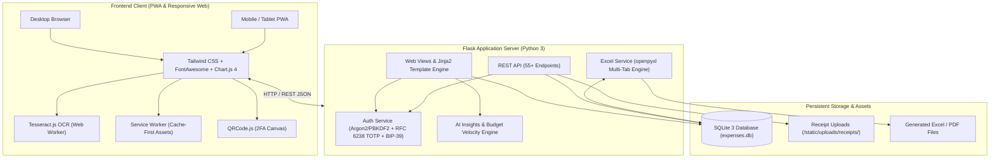

# 💰 FinanceFlow — Personal Expense & Wealth Tracker (v2.0.0)

<div align="center">

[](https://github.com/Akhil-Binu/personal-expense-tracker/releases/tag/v2.0.0)
[](https://akhilbinu.pythonanywhere.com)
[](https://www.python.org/)
[](https://flask.palletsprojects.com/)
[](https://www.sqlite.org/)
[](https://web.dev/progressive-web-apps/)
[](https://tesseract.projectnaptha.com/)
[](LICENSE)

<br/>

**A modern, full-stack Personal Expense & Wealth Management Web Application built with Python, SQLite, and Progressive Web App (PWA) capabilities.**  
Track daily spending and income streams, reconcile multi-account balances, manage recurring subscriptions, monitor financial goals, run client-side AI receipt OCR scans, stay protected with RFC 6238 TOTP Two-Factor Authentication, and export publication-ready PDF statements.

[Live Demo](https://akhilbinu.pythonanywhere.com) • [v2.0 Features](#-whats-new-in-v20) • [Quick Start](#-quick-start-guide) • [Architecture](#-architecture--tech-stack) • [API Docs](#-rest-api-reference) • [Release Notes](#-v200-release-notes)

</div>

---

## 📖 Table of Contents

- [What's New in Version 2.0](#-whats-new-in-v20)
- [Key Features](#-key-features)
- [Live Demo & Cloud Deployment](#-live-demo--cloud-deployment)
- [Architecture & Tech Stack](#-architecture--tech-stack)
- [Quick Start Guide](#-quick-start-guide)
- [Progressive Web App (PWA) & Mobile Installation](#-progressive-web-app-pwa--mobile-installation)
- [Income Streams & Net Cash Flow](#-income-streams--net-cash-flow)
- [Recurring Bills & Subscriptions](#-recurring-bills--subscriptions)
- [Financial Goals & Savings Pockets](#-financial-goals--savings-pockets)
- [Smart AI Receipt OCR Scanner](#-smart-ai-receipt-ocr-scanner)
- [Smart AI Spending Insights & Budget Velocity](#-smart-ai-spending-insights--budget-velocity)
- [Two-Factor Authentication (2FA) Security](#-two-factor-authentication-2fa-security)
- [Debts, Loans & Peer Credit](#-debts-loans--peer-credit)
- [Printable Financial Statements & PDF Export](#-printable-financial-statements--pdf-export)
- [Interactive Monthly Budget Editor](#-interactive-monthly-budget-editor)
- [Excel Spreadsheet Integration](#-excel-spreadsheet-integration)
- [REST API Reference](#-rest-api-reference)
- [Automated Testing Suite](#-automated-testing-suite)
- [Repository Structure](#-repository-structure)
- [v2.0.0 Release Notes](#-v200-release-notes)
- [License](#-license)

---

## 🚀 What's New in Version 2.0

FinanceFlow v2.0 evolves from an expense tracker into a comprehensive **personal finance and wealth management hub**:

1. 💵 **Income Streams & Net Cash Flow Ledger**: Complete tracking of monthly salaries, freelance income, investments, and side hustles. Real-time net savings rate calculations and inter-account transfers with automatic balance reconciliation.
2. 🔁 **Recurring Bills & Subscriptions Tracker**: Track Netflix, Spotify, gym memberships, utilities, and software licenses. Visual due date countdowns, monthly commitment summaries, and **1-click "Mark as Paid"** logging.
3. 🎯 **Financial Goals & Savings Pockets**: Set savings milestones (e.g., *Emergency Fund, Vacation, Down Payment*) with target dates, visual progress rings, recommended monthly savings pace calculators, and 1-click contributions.
4. 🧾 **Smart Browser-Side AI Receipt OCR Scanner**: Point camera or upload receipt images directly in browser. Utilizes **Tesseract.js** in a Web Worker to extract transaction amounts, dates, and vendor names with zero server lag.
5. 🧠 **AI Spending Insights & Budget Velocity Engine**: Proactively detects budget burn acceleration, alerts on overruns before month-end, and suggests optimizations based on historical trends.
6. 📱 **Progressive Web App (PWA) Capabilities**: Install directly to iOS and Android home screens as a standalone app with offline asset caching and service worker support.
7. 🖨️ **Printable Executive Financial Statements & PDF Export**: Dedicated `/statement` route optimized for `@media print` layout and clean PDF export.
8. 🛡️ **RFC 6238 TOTP Two-Factor Authentication (2FA)**: High-security authentication pairing with Google Authenticator, Authy, or 1Password via QR code canvas, backed by 12-word mnemonic recovery phrase fallback.

---

## ✨ Key Features

- 🏛️ **Multi-Bank Accounts & Consolidated Net Worth**: Track checking, savings, credit cards, digital wallets, and brokerage accounts. Calculates real-time balances: `Current Balance = Initial Balance + Income - Expenses + Transfers In - Transfers Out`.
- 🎯 **Interactive Budget Velocity Editor**: Set overall target budgets with 1-click **proportional auto-scaling**, **even split**, and per-category limits.
- 🔐 **Decentralized 12-Word Mnemonic Recovery**: BIP-39 compatible 12-word backup keywords for zero-email password recovery.
- 💵 **Multi-Currency Engine**: Seamless live switching across **USD ($)**, **INR (₹)**, **EUR (€)**, **GBP (£)**, **JPY (¥)**, **CAD (C$)**, **AUD (A$)**, **AED**, **SGD (S$)**, and **CHF**.
- 📊 **Dynamic Visualizations**: High-performance Chart.js charts for category distribution, daily trends, 6-month comparisons, and payment methods.
- 📑 **Executive Excel Engine**: Multi-sheet `.xlsx` reports featuring live Excel formulas (`=SUM(...)`), currency formatting, and auto-filters.
- 🌓 **Dark / Light Mode**: Instant theme switching with persistent local storage and automated Chart.js palette synchronization.

---

## 🌐 Live Demo & Cloud Deployment

FinanceFlow is deployed and accessible worldwide:

- **Live URL**: [https://akhilbinu.pythonanywhere.com](https://akhilbinu.pythonanywhere.com)
- **Demo Credentials**:
  - **Username**: `admin`
  - **Password**: `admin123` *(or register your own private account in seconds)*

---

## 🏗️ Architecture & Tech Stack



- **Backend**: Python 3.10+ & Flask 3.1
- **Database**: SQLite3 with strict foreign keys, multi-user schemas, and compound index optimization
- **Spreadsheets & Reporting**: `openpyxl` for multi-tab `.xlsx` workbooks
- **Frontend**: HTML5, Tailwind CSS, FontAwesome 6, Chart.js 4, QRCode.js
- **Client-Side AI**: Tesseract.js Web Worker for receipt scanning
- **Security**: Salted PBKDF2-HMAC-SHA256 password hashing, pure-Python RFC 6238 TOTP, and 12-word mnemonic backup phrases

---

## 🚀 Quick Start Guide

### 1. Clone the Repository
```bash
git clone https://github.com/Akhil-Binu/personal-expense-tracker.git
cd personal-expense-tracker
```

### 2. Set Up Virtual Environment
```bash
# Create virtual environment
python -m venv .venv

# Activate on Windows PowerShell:
.\.venv\Scripts\Activate.ps1
# Or Windows Command Prompt:
.\.venv\Scripts\activate.bat
# Or macOS/Linux:
source .venv/bin/activate
```

### 3. Install Dependencies
```bash
pip install -r requirements.txt
```

### 4. Launch Application
```bash
python run.py
```

The smart launcher will display access URLs and open your browser:
- **Desktop**: `http://localhost:5000`
- **Mobile / Tablet (Same Wi-Fi)**: `http://<your-lan-ip>:5000` *(e.g. `http://192.168.1.50:5000`)*

---

## 📱 Progressive Web App (PWA) & Mobile Installation

FinanceFlow v2.0 is an installable Progressive Web App:

1. Open `http://localhost:5000` or the live demo `https://akhilbinu.pythonanywhere.com` on your mobile browser (Safari on iOS or Chrome on Android).
2. Tap the browser share / options menu.
3. Select **"Add to Home Screen"**.
4. FinanceFlow will launch in standalone full-screen mode with an app icon on your home screen, independent window controls, and offline asset caching via `service-worker.js`.

---

## 💵 Income Streams & Net Cash Flow

- **Income Logging**: Record recurring salaries, freelance milestones, dividends, and interest payments with linked bank accounts.
- **Net Cash Flow Ledger**: Calculates `Net Cash Flow = Total Income - Total Expenses` and displays your monthly **Savings Rate (%)**.
- **Inter-Account Transfers**: Move funds between Checking, Savings, and Wallets with full balance reconciliation and transfer history.

---

## 🔁 Recurring Bills & Subscriptions

- **Commitment Tracker**: Log all recurring monthly, weekly, quarterly, or yearly subscriptions.
- **Due Date Countdowns**: Visual badges indicate days remaining until renewal.
- **1-Click "Mark as Paid"**: When a bill is due, click **"Pay"** to automatically log the transaction under its assigned category and bank account and advance the next due date by one billing cycle.

---

## 🎯 Financial Goals & Savings Pockets

- **Custom Savings Targets**: Create goals for emergency funds, vacations, investments, or gadget upgrades.
- **Progress Tracking**: Real-time progress percentage rings and remaining balance counters.
- **Automated Savings Pace**: Dynamically calculates `Suggested Monthly Savings` based on your deadline.
- **1-Click Contributions**: Deposit funds directly from any bank account into a savings goal with instant balance deduction.

---

## 🧾 Smart AI Receipt OCR Scanner

- **Browser-Side OCR**: Uses **Tesseract.js** in a background Web Worker to parse receipt text without sending raw images to heavy third-party servers.
- **Automated Field Extraction**: Uses regular expressions and token heuristics to identify:
  - **Total Amount**: Finds lines with `TOTAL`, `BALANCE DUE`, `AMOUNT`, or currency markers.
  - **Date**: Extracts formats like `YYYY-MM-DD`, `DD/MM/YYYY`, or `Month DD, YYYY`.
  - **Vendor / Description**: Suggests merchant name from receipt header text.
- **Secure File Storage**: Attaches receipt images to expenses with an interactive in-browser lightbox modal viewer.

---

## 🧠 Smart AI Spending Insights & Budget Velocity

The built-in analytics engine (`analytics_service.py`) provides real-time financial intelligence:

- **Budget Velocity**: Compares days passed in the month against budget consumption percentage to calculate daily run rate and forecast month-end overruns.
- **Overrun Warnings**: Color-coded danger/warning badges pinpoint which categories require immediate attention.
- **Savings Rate Benchmarks**: Assesses whether your retained savings exceed the healthy 20% rule.
- **Upcoming Bills Summary**: Highlights subscriptions renewing within the next 7 days and calculates annual commitments.

---

## 🛡️ Two-Factor Authentication (2FA) Security

- **RFC 6238 TOTP Standard**: Compatible with all standard authenticator apps (Google Authenticator, Microsoft Authenticator, Authy, 1Password, Bitwarden).
- **Interactive QR Code Canvas**: Generated on the client using `qrcode.js` for instant smartphone camera scanning.
- **Mnemonic Fallback**: If an authenticator device is lost, users can bypass 2FA using their 12-word BIP-39 recovery keywords.
- **Zero Remote Dependencies**: TOTP generation and validation implemented purely in Python standard library (`hmac`, `hashlib`, `struct`).

---


## 🤝 Debts, Loans & Peer Credit

Manage all borrowing and lending relationships with complete two-way reconciliation:

- **Peer Credit (Friends & Family)**:
  - 🟢 **Given to Friends (Lent / Receivables)**: Record money you lent to friends for split bills, trip expenses, or concert tickets. Marked as an asset to be collected.
  - 🔴 **Taken from Friends (Borrowed / Payables)**: Record money borrowed from friends that you need to pay back. Marked as a liability.
- **Formal Bank Loans & EMIs**:
  - Track Auto, Student, Personal, and Mortgage loans with principal amounts, interest rates (APR %), target payoff dates, and monthly EMIs.
- **Credit Cards & Revolving Credit**:
  - Track statement balances, limits, and payment due dates.
- **1-Click Repayment Engine**:
  - Click **"Record Repayment"** on any debt to log partial or full payments with automatic status advancement to `Settled`.
  - **Automated Bank Reconciliation**: When receiving payment from a friend, automatically credit your selected bank account. When paying back a loan or friend, automatically debit your account and record the expense.
- **Net Debt Position**:
  - Real-time calculation: `Net Position = Total Owed to You (Receivables) - Total You Owe (Payables)`.

---

## 🖨️ Printable Financial Statements & PDF Export

Navigate to `/statement` to view an executive statement for any custom date range:
- Branded letterhead and period summary
- Executive Cash Flow & Net Savings KPIs
- Income stream ledger
- Categorized expense summary
- Individual bank account balances
- Built-in `@media print` CSS stylesheet: clicking **"Print / Export PDF"** triggers clean formatting with hidden navigation chrome, page breaks, and high-contrast typography.

---

## 🎯 Interactive Monthly Budget Editor

- **Arbitrary Overall Monthly Budget Ceiling**: Set any amount as your overall monthly spending limit (e.g. $4,000/month) directly, without requiring allocation into specific categories.
- **Optional Category Limits (Uncapped / Flexible)**: Category spending limits are completely optional. Categories set to $0.00 or left blank are treated as Uncapped/Flexible and won't trigger false over-budget warnings.
- **Quick Tool Suite**:
  - **Auto-Scale by %**: Proportionally scales existing category limits to match the target ceiling.
  - **Split Evenly**: Divides the target ceiling equally across all categories.
  - **Uncap All**: 1-click clears all individual limits so spending is tracked purely against your total monthly budget.
  - **Match Sum**: Automatically sets your overall budget to match the exact sum of all category limits.
- **Dashboard & Category Views**: All KPIs, remaining buffers, pace meters, and reports immediately update to reflect your overall budget ceiling.

---

## 📑 Excel Spreadsheet Integration

- **Multi-Sheet Export (`.xlsx`)**:
  - *Sheet 1 (Executive Summary)*: KPI cards, category table with live `=B9-C9` formulas, payment method breakdown.
  - *Sheet 2 (All Transactions)*: Detailed log with `=SUM(...)` totals and auto-filters.
  - *Sheet 3 (Bank Accounts)*: Complete list of accounts, initial balances, deductions, and consolidated net worth.
- **Bulk Spreadsheet Import**: Upload `.xlsx` files to import historical data with automatic category creation. Pre-formatted starter template downloadable with 1-click.

---

## 🔌 REST API Reference

| Method | Endpoint | Description |
| :--- | :--- | :--- |
| `POST` | `/register` | Register new account and generate 12 backup keywords |
| `POST` | `/login` | Authenticate user credentials (prompts for 2FA if enabled) |
| `POST` | `/verify-2fa` | Complete login session using 6-digit TOTP code or backup phrase |
| `POST` | `/recover` | Reset password using 12 backup keywords |
| `POST` | `/api/2fa/setup` | Generate TOTP secret and QR code URI for user |
| `POST` | `/api/2fa/verify-and-enable` | Verify 6-digit code and activate 2FA on account |
| `POST` | `/api/2fa/disable` | Disable 2FA on account |
| `GET` | `/api/2fa/status` | Check if 2FA is currently active for authenticated user |
| `GET` | `/api/income` | List user income streams for selected month or range |
| `POST` | `/api/income` | Add a new income stream and credit bank account |
| `GET/PUT/DELETE` | `/api/income/<id>` | Retrieve, edit, or delete an income record |
| `POST` | `/api/transfer` | Execute an inter-account fund transfer |
| `DELETE` | `/api/transfer/<id>` | Delete an inter-account transfer and revert balances |
| `GET` | `/api/subscription` | List all recurring subscriptions |
| `POST` | `/api/subscription` | Create a new recurring subscription |
| `GET/PUT/DELETE` | `/api/subscription/<id>`| Retrieve, update, or delete a recurring subscription |
| `POST` | `/api/subscription/<id>/pay`| 1-click mark bill paid, log expense, and advance due date |
| `GET` | `/api/goal` | List all savings goals and completion percentages |
| `POST` | `/api/goal` | Create a new financial goal |
| `GET/PUT/DELETE` | `/api/goal/<id>` | Retrieve, update, or delete a savings goal |
| `GET` | `/api/debt` | List debts & peer credit with optional type and status filters |
| `POST` | `/api/debt` | Create a new peer debt, bank loan, or credit card record |
| `GET/PUT/DELETE` | `/api/debt/<id>` | Retrieve, update, or delete a debt record |
| `POST` | `/api/debt/<id>/payment` | Record a partial or full repayment with bank balance update |
| `GET` | `/api/debt/summary` | Retrieve total receivables, payables, and net position metrics |
| `POST` | `/api/goal/<id>/contribute` | Deposit funds from bank account into a savings goal |
| `GET` | `/api/insights` | Retrieve AI spending insights and budget alerts |
| `GET` | `/api/chart-data` | Retrieve series data for category, daily, history, and payment charts |
| `POST` | `/api/expense` | Add expense (supports multipart receipt upload) |
| `GET/PUT/DELETE` | `/api/expense/<id>` | Retrieve, update, or delete an expense record |
| `GET` | `/api/account` | Retrieve all bank accounts and calculated net balances |
| `POST` | `/api/account` | Create a new bank account with starting balance |
| `GET/PUT/DELETE` | `/api/account/<id>` | Retrieve, update, or delete a bank account |
| `GET/POST`| `/api/budget` | Retrieve or batch update category monthly budgets |
| `PUT` | `/api/category/<id>/budget`| Update single category monthly budget |
| `GET/POST`| `/api/settings/currency` | Get or update active currency |
| `GET` | `/export/excel` | Download formatted multi-sheet `.xlsx` report |
| `GET` | `/export/template` | Download Excel starter import template |
| `POST` | `/import/excel` | Upload `.xlsx` file and bulk import transactions |

---

## 🧪 Automated Testing Suite

FinanceFlow v2.0 features an automated test suite verifying all core database operations, API endpoints, PWA assets, income/transfers, subscriptions, goals, 2FA security, AI insights, and receipt handling:

```bash
.\.venv\Scripts\python.exe -m unittest test_app.py
```

Output:
```
..................
----------------------------------------------------------------------
Ran 19 tests in 2.538s

OK
```

---

## 📁 Repository Structure

```
personal-expense-tracker/
├── app.py                   # Flask server, authentication, v2.0 routes & 55+ REST endpoints
├── database.py              # SQLite schema migrations, multi-account ledger, income & goals
├── auth_service.py          # Salted password hashing, RFC 6238 TOTP, and BIP-39 recovery
├── analytics_service.py     # AI Spending Insights & Budget Velocity calculation engine
├── excel_service.py         # openpyxl multi-tab formatted workbook generator & parser
├── run.py                   # Smart launcher with local LAN IP resolution
├── test_app.py              # Comprehensive test suite (18 unit tests, 100% passing)
├── requirements.txt         # Frozen dependencies
├── LICENSE                  # MIT License
├── README.md                # Project documentation & release manual
├── static/
│   ├── css/
│   │   └── style.css        # Responsive styles, mobile touch rules, print stylesheet
│   ├── js/
│   │   └── app.js           # PWA SW reg, Tesseract OCR scanner, 2FA QRCode, Charts, Modals
│   ├── icons/
│   │   ├── icon-192.svg     # Scalable PWA app icon (192x192)
│   │   └── icon-512.svg     # Scalable PWA app icon (512x512)
│   ├── uploads/
│   │   └── receipts/        # Directory for attached receipt scans & photos
│   ├── manifest.json        # PWA application manifest
│   └── service-worker.js    # Service worker with Cache-First static asset caching
└── templates/
    ├── base.html            # Main layout with PWA headers, v2.0 navigation & global modals
    ├── index.html           # Dashboard (Cash Flow banner, AI insights, velocity, charts)
    ├── expenses.html        # Expense table, receipt badges, search & filters
    ├── income.html          # Income streams ledger, category breakdown & metrics
    ├── subscriptions.html   # Recurring bills grid, countdowns & 1-click pay
    ├── goals.html           # Savings goals, progress bars & contribution modal
    ├── statement.html       # Publication-ready printable financial statement & PDF export
    ├── accounts.html        # Bank Accounts, Quick Transfers & aggregated Net Worth
    ├── reports.html         # Monthly analytics, 4 Chart.js graphs & budget variance
    ├── categories.html      # Category budgets, limits & progress bars
    ├── login.html           # Clean login interface with recovery link
    ├── verify_2fa.html      # TOTP 2FA challenge page with backup phrase fallback
    ├── register.html        # Account creation interface
    ├── backup_keywords.html # 12-word mnemonic recovery phrase card
    └── recover.html         # Account recovery & password reset using 12 keywords
```

---

## 📦 v2.0.0 Release Notes

### **v2.0.0 — Wealth Management & Security Upgrade**
*Date: October 29, 2026*

- 💵 **Net Cash Flow & Income Streams**: Track income sources, monthly savings rate, and account-to-account transfers with automatic balance reconciliation.
- 🔁 **Subscriptions & Recurring Bills**: Dedicated subscription dashboard with due date countdowns, annual commitment calculations, and 1-click pay logging.
- 🎯 **Financial Goals & Savings Pockets**: Savings milestones with visual progress indicators, target date pace calculators, and 1-click bank contributions.
- 🧾 **AI Receipt OCR Scanner**: Client-side OCR via Tesseract.js in a Web Worker, automatic extraction of total/date/vendor, and receipt lightbox viewer.
- 🧠 **AI Spending Insights**: Real-time spending velocity alerts, burn rate analysis, and smart budgeting guidance.
- 📱 **Progressive Web App (PWA)**: Full manifest, vector brand icons, and offline service worker caching for installable home screen experience on iOS/Android.
- 🖨️ **Printable Financial Statement & PDF Export**: Executive `@media print` statement generator with KPI banners and tabular ledgers.
- 🛡️ **RFC 6238 TOTP Two-Factor Authentication**: Pure Python 2FA security with QR code canvas pairing and mnemonic phrase fallback.
- 🧪 **Expanded Test Suite**: 18 automated integration tests covering all v2.0 endpoints with 100% pass rate.
- ☁️ **Live Deployment**: Live release deployed on PythonAnywhere at `https://akhilbinu.pythonanywhere.com`.

---

## 📄 License

This project is open-source under the [MIT License](LICENSE).
