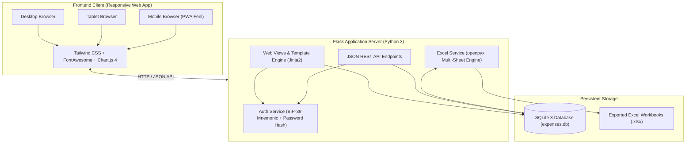

# 💰 FinanceFlow — Personal Expense Tracker

<div align="center">

[](https://github.com/Akhil-Binu/personal-expense-tracker/releases/tag/v1.0.0)
[](https://www.python.org/)
[](https://flask.palletsprojects.com/)
[](https://www.sqlite.org/)
[](https://openpyxl.readthedocs.io/)
[](https://tailwindcss.com/)
[](https://www.chartjs.org/)
[](LICENSE)

<br/>

**A sleek, responsive, and full-featured Personal Expense Tracker built with Python, SQLite, and Excel.**  
Track daily spending, categorize transactions, manage multiple bank accounts with an aggregated combined net balance, adjust monthly budgets, explore visual analytics, and export multi-sheet Excel reports — natively responsive across **Mobile**, **Tablet**, and **Desktop** devices.

[Features](#-key-features) • [Quick Start](#-quick-start-guide) • [Multi-Device](#-multi-device-responsive-design) • [Architecture](#-architecture) • [API Docs](#-rest-api-reference) • [Release Notes](#-v100-release-notes)

</div>

---

## 📖 Table of Contents

- [Key Features](#-key-features)
- [Multi-Device Responsive Design](#-multi-device-responsive-design)
- [Architecture & Tech Stack](#-architecture--tech-stack)
- [Quick Start Guide](#-quick-start-guide)
- [Mobile & Tablet Setup](#-accessing-on-mobile--tablet)
- [Multi-Bank Accounts & Combined Balance](#-multi-bank-accounts--combined-balance)
- [Interactive Monthly Budget Editor](#-interactive-monthly-budget-editor)
- [Excel Spreadsheet Integration](#-excel-spreadsheet-integration)
- [Decentralized Account Recovery](#-account-creation--backup-keywords-system)
- [Supported Currencies](#-supported-currencies)
- [REST API Reference](#-rest-api-reference)
- [Automated Testing Suite](#-automated-testing-suite)
- [Repository Structure](#-repository-structure)
- [v1.0.0 Release Notes](#-v100-release-notes)
- [License](#-license)

---

## ✨ Key Features

- 🏛️ **Multi-Bank Accounts & Combined Net Balance**: Link and manage multiple checking, savings, digital wallets (UPI/PayPal/Apple Cash), and investment accounts. Automatically aggregate starting balances minus all categorized expenses into **one combined net financial balance**.
- 🎯 **Interactive Monthly Budget Editor**: Easily set and edit overall monthly budget targets directly from the Dashboard or Categories view. Features **1-click proportional auto-scaling**, **even split**, and fine-grained per-category limit inputs with real-time recalculation.
- 🔐 **Account Creation & 12-Word Mnemonic Backup**: Create private user accounts with decentralized 12-word backup recovery phrases (BIP-39 standard). Reset passwords and recover accounts securely without relying on third-party email services.
- 📱 **Responsive Multi-Device Web App**: Custom adaptive interfaces optimized for **Mobile** (bottom navigation bar, floating `+` quick-add button, touch-friendly bottom sheets), **Tablet** (adaptive 2-column cards), and **Desktop** (comprehensive metrics strip and left navigation sidebar).
- 💵 **Dynamic 10+ Multi-Currency Engine**: Switch currencies on the fly across **USD ($)**, **INR (₹)**, **EUR (€)**, **GBP (£)**, **JPY (¥)**, **CAD (C$)**, **AUD (A$)**, **AED**, **SGD (S$)**, and **CHF**. Updates all charts, tables, budgets, and Excel exports dynamically.
- 📊 **Interactive Financial Analytics**: High-performance Chart.js graphs for category distribution (doughnut), daily spending trends (bar), 6-month historical comparisons, and payment method share.
- 📑 **Executive Excel Integration**: Export multi-sheet `.xlsx` reports featuring live Excel formulas (`=SUM(...)`), currency formatting, zebra striping, auto-filters, and dedicated sheets for Executive Summary, Transactions, and Bank Accounts.
- 📥 **Spreadsheet Import & Template**: Bulk import expense histories from Excel workbooks with automated category resolution, plus 1-click starter template download.
- 🌓 **Dark / Light Mode**: Instant theme switching with persistent user preference and automatic Chart.js palette synchronization.

---

## 📱 Multi-Device Responsive Design

FinanceFlow is built from the ground up to provide a first-class native app experience on any screen size:

| Platform | Layout & Interaction Highlights |
| :--- | :--- |
| **Desktop Web App** | Fixed left sidebar navigation, top metrics bar with currency & month pickers, side-by-side interactive charts, full-featured transactional data table with multi-criteria filters, and quick modal popups. |
| **Tablet Web App** | Touch-optimized 2-column layout, adaptive charts that rescale gracefully on rotation, comfortable tap targets, and responsive category budget cards. |
| **Mobile Web App** | Native bottom navigation bar (*Home, Expenses, Floating Quick-Add (+), Accounts, Reports*), mobile card transactions, numeric keyboard optimization (`inputmode="decimal"`), and touch-friendly bottom sheets. |

---

## 🏗️ Architecture & Tech Stack



- **Backend**: Python 3.10+ & Flask 3.1
- **Database**: SQLite3 with foreign keys, transactional integrity, and compound indexes
- **Spreadsheets / Reporting**: `openpyxl` (multi-sheet formatted `.xlsx` generation & parsing)
- **Frontend**: HTML5, Tailwind CSS, FontAwesome 6, Chart.js 4
- **Security**: Salted Werkzeug password hashing & 12-word recovery phrase verification

---

## 🚀 Quick Start Guide

### 1. Clone the Repository
```bash
git clone https://github.com/Akhil-Binu/personal-expense-tracker.git
cd personal-expense-tracker
```

### 2. Set Up Python Virtual Environment
```bash
# Create virtual environment
python -m venv .venv

# Activate on Windows PowerShell:
.\.venv\Scripts\Activate.ps1
# Or Windows Command Prompt:
.\.venv\Scripts\activate.bat
# Or macOS/Linux:
source .venv/bin/activate
```

### 3. Install Dependencies
```bash
pip install -r requirements.txt
```

### 4. Run the Application
```bash
python run.py
```

The smart launcher will display local and Wi-Fi access links and automatically open your default browser:
- **Desktop Web App**: `http://localhost:5000`
- **Mobile / Tablet (on same Wi-Fi)**: `http://<your-lan-ip>:5000` *(e.g. `http://192.168.1.50:5000`)*

---

## 📲 Accessing on Mobile & Tablet

1. Connect your smartphone or tablet to the **same Wi-Fi network** as your host computer.
2. Launch `python run.py`.
3. Note the **Tablet / Mobile URL** printed in the terminal (e.g., `http://192.168.x.x:5000`).
4. Open Chrome or Safari on your phone and browse to that address.
5. *(Tip)* Tap **"Add to Home Screen"** in Safari / Chrome for a standalone full-screen web app experience!

---

## 🏛️ Multi-Bank Accounts & Combined Balance

FinanceFlow makes managing multiple accounts effortless:

- **Add Multiple Accounts**: Create accounts for Checking, Savings, Digital Wallets (UPI, PayPal, Apple Cash), Credit Cards, or Brokerage.
- **Custom Visuals**: Assign custom colors and icons (`fa-building-columns`, `fa-piggy-bank`, `fa-wallet`, `fa-credit-card`, `fa-mobile-screen`, `fa-vault`).
- **Initial Balances & Masked Numbers**: Record starting funds and optional last 4 digits (e.g. `•••• 4821`).
- **Automated Expense Deductions**: When logging an expense, pick which bank account paid for it. The system automatically reduces that account's balance in real time.
- **Combined Net Balance**: View an aggregated real-time calculation of your total net worth across all bank accounts in one central banner.
- **Type Breakdown**: View aggregated balances grouped by account type (*Checking, Savings, Wallets*).

---

## 🎯 Interactive Monthly Budget Editor

Take full control of your monthly spending targets:

- **Quick Dashboard Editing**: Click the **"Edit"** button on the Dashboard's **Monthly Budget KPI card** to adjust budgets without navigating away.
- **Overall Target Budget**: Type a total target budget (e.g., `$3,500.00`).
- **Auto-Scale Proportionally**: 1-click button that scales all category spending limits proportionally to match your new target while preserving spending ratios.
- **Split Evenly**: 1-click button that divides the target budget equally among all categories.
- **Per-Category Controls**: Numeric inputs for each individual category with live percentage allocations that recalculate in real-time.
- **Visual Thresholds**: Color-coded indicators notify you when a category is *On Track (<80%)*, *Near Limit (80-100%)*, or *Over Budget (>100%)*.

---

## 📑 Excel Spreadsheet Integration

### 1. Multi-Sheet Executive Summary Export (.xlsx)
Generates an Excel workbook formatted with executive aesthetics:
- **Sheet 1: Executive Summary**:
  - Branded header banner and KPI cards (*Total Spent, Monthly Budget, Remaining Buffer, Daily Average, Total Transactions, Top Category*).
  - Category Breakdown Table with live formulas (`=B9-C9`), budget utilization percentage, and active currency formatting.
  - Payment Methods Overview with transaction shares.
- **Sheet 2: All Transactions**:
  - Full transactional log: ID, Date, Category, Description, Payment Method, Bank Account, Amount, Notes.
  - Native Excel `=SUM(...)` total formula and table auto-filters enabled.
- **Sheet 3: Bank Accounts & Net Balance**:
  - Breakdown of all bank accounts, starting balances, deductions, and current net balances.
  - Bottom row with `=SUM(...)` formula computing the **Combined Total Net Balance**.

### 2. Bulk Spreadsheet Import
- Click **"Import"** or **"Import Excel"** to upload any `.xlsx` spreadsheet.
- Maps headers (`Date`, `Category`, `Amount`, `Payment Method`, `Description`, `Notes`).
- Auto-creates new categories if they do not exist.
- Download a pre-formatted template with 1-click via the import dialog.

---

## 🔐 Account Creation & Backup Keywords System

FinanceFlow includes user authentication designed for privacy and resilience:

1. **Sign Up**:
   - Create your personal account with a unique username and password.
   - The app automatically creates a private sandbox for your expenses and budgets.

2. **12-Word Backup Keywords (Recovery Phrase)**:
   - When registering, FinanceFlow generates **12 cryptographically random, memorable dictionary words** (e.g., `acorn amber anchor beacon blossom clover...`).
   - You can copy them or download them as a `.txt` file.
   - The recovery phrase is securely hashed in SQLite using salted Werkzeug hashes.

3. **Account Recovery & Password Reset**:
   - If you ever forget your password, navigate to **Forgot Password?** (`/recover`).
   - Enter your username, type or paste your **12 backup keywords**, and set your new password.
   - Instant recovery with **zero external email dependencies**.

---

## 🪙 Supported Currencies

Switch between currencies anytime from the top navigation bar:

| Currency | Code | Symbol | Sample Format |
| :--- | :--- | :---: | :--- |
| **US Dollar** | `USD` | `$` | `$1,250.00` |
| **Indian Rupee** | `INR` | `₹` | `₹1,250.00` |
| **Euro** | `EUR` | `€` | `€1,250.00` |
| **British Pound** | `GBP` | `£` | `£1,250.00` |
| **Japanese Yen** | `JPY` | `¥` | `¥1,250.00` |
| **Canadian Dollar** | `CAD` | `C$` | `C$1,250.00` |
| **Australian Dollar** | `AUD` | `A$` | `A$1,250.00` |
| **UAE Dirham** | `AED` | `AED` | `AED 1,250.00` |
| **Singapore Dollar** | `SGD` | `S$` | `S$1,250.00` |
| **Swiss Franc** | `CHF` | `CHF` | `CHF 1,250.00` |

---

## 🔌 REST API Reference

| Method | Endpoint | Description |
| :--- | :--- | :--- |
| `POST` | `/register` | Register a new user account and receive 12 backup keywords |
| `POST` | `/login` | Authenticate user credentials and create session |
| `POST` | `/recover` | Reset password using 12 mnemonic backup keywords |
| `GET` | `/api/chart-data` | Retrieve series data for category, daily, history, and payment charts |
| `POST` | `/api/expense` | Add a new expense (with optional `account_id` deduction) |
| `GET` | `/api/expense/<id>` | Retrieve single expense record details |
| `PUT` | `/api/expense/<id>` | Update an existing expense record |
| `POST` | `/api/expense/<id>/delete` | Delete an expense record |
| `GET` | `/api/account` | Retrieve list of all user bank accounts and balances |
| `POST` | `/api/account` | Add a new bank account with initial balance |
| `GET` | `/api/account/<id>` | Retrieve single bank account details |
| `PUT` | `/api/account/<id>` | Update bank account details |
| `POST` | `/api/account/<id>/delete` | Delete a bank account (safely unlinks transactions) |
| `GET` | `/api/budget` | Retrieve total budget, spend, and all category limits |
| `POST` | `/api/budget` | Update monthly budget (batch categories or proportional target) |
| `PUT` | `/api/category/<id>/budget`| Update single category monthly budget |
| `POST` | `/api/category` | Create a new custom category |
| `PUT` | `/api/category/<id>` | Update category name, icon, color, and budget |
| `POST` | `/api/category/<id>/delete` | Delete a category (if no transactions linked) |
| `GET/POST`| `/api/settings/currency` | Get or update the active currency |
| `GET` | `/export/excel` | Download formatted multi-sheet `.xlsx` report |
| `POST` | `/import/excel` | Upload `.xlsx` file and bulk import expenses |

---

## 🧪 Automated Testing Suite

FinanceFlow includes an automated unit test suite covering authentication, multi-bank accounts, combined balance aggregation, budget scaling, expense CRUD, currency changes, and Excel import/export:

```bash
.\.venv\Scripts\python.exe -m unittest test_app.py
```

Output:
```
...........
----------------------------------------------------------------------
Ran 11 tests in 1.848s

OK
```

---

## 📁 Repository Structure

```
personal-expense-tracker/
├── app.py                # Flask server, authentication, page routes & REST endpoints (v1.0.0)
├── auth_service.py       # Password hashing & 12-word mnemonic recovery phrase generator
├── database.py           # SQLite connection, multi-user schema & transactional queries
├── excel_service.py      # openpyxl formatted workbook generator & parser
├── run.py                # Smart launcher with local LAN IP resolution
├── test_app.py           # Comprehensive unit tests (all 11 tests passing)
├── requirements.txt      # Frozen pip dependencies
├── .gitignore            # Git exclusion rules
├── LICENSE               # MIT License
├── README.md             # Project documentation & release manual
├── static/
│   ├── css/
│   │   └── style.css     # Responsive styles, mobile touch rules, toast animations
│   └── js/
│       └── app.js        # Theme manager, Chart.js renderers, modals, currency API, accounts
└── templates/
    ├── base.html         # Responsive base layout (Desktop sidebar + Mobile bottom nav)
    ├── login.html        # Clean login interface with recovery link
    ├── register.html     # Account creation interface
    ├── backup_keywords.html # 12-word mnemonic keywords presentation card
    ├── recover.html      # Account recovery & password reset using 12 keywords
    ├── index.html        # Main dashboard (Combined Balance banner, KPI cards, charts)
    ├── accounts.html     # Bank Accounts & Combined Net Balance management view
    ├── expenses.html     # Expenses table, advanced filters, search & Excel export
    ├── reports.html      # Monthly reports, 4 interactive charts, variance table
    └── categories.html   # Category budgets, limits & progress bars
```

---

## 📦 v1.0.0 Release Notes

### **v1.0.0 — Initial Official Release**
*Date: October 25, 2026*

- **Multi-Bank Account Engine**: Support for multiple bank accounts, initial balance tracking, transaction linking, and aggregated combined net balance calculation.
- **Interactive Monthly Budget Editor**: Modal budget editor with proportional auto-scaling, even distribution, and per-category limits.
- **Decentralized User Accounts**: Mnemonic 12-word recovery keywords system for zero-email account reset.
- **Multi-Currency System**: 10+ global currencies supported with dynamic UI and Excel formatting.
- **Executive Excel Engine**: 3-sheet `.xlsx` export (Summary, All Transactions, Bank Accounts) with live `=SUM(...)` formulas.
- **Full Responsive Experience**: Native app feel on Mobile, Tablet, and Desktop web browsers.
- **Automated Test Coverage**: 11 unit tests ensuring zero regression across core functionality.

---

## 📄 License

This project is open-source under the [MIT License](LICENSE).
